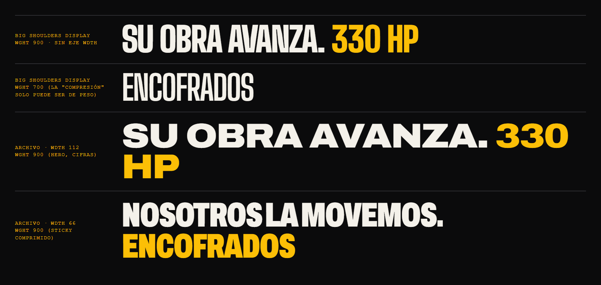

# Hoja de estilo visual — MAVI

Principio rector: **hoja de especificaciones de máquina + señalética de obra**. Todo lo que se ve debe poder existir pintado en un equipo, impreso en un plano o cosido en una cinta de seguridad.

## 1. Tipografía

Todas OFL 1.1, self-hosted (`app/fonts/*.woff2`, subconjunto latino) vía `next/font/local`, con `font-display: swap` salvo Saira Stencil (`optional`: es decorativa y no debe provocar un intercambio de fuente). Archivo y Hanken se precargan. Nada se carga de Google en runtime.

| Rol       | Familia                       | Ejes usados                             | Uso                                                                                                     |
| --------- | ----------------------------- | --------------------------------------- | ------------------------------------------------------------------------------------------------------- |
| Display   | **Archivo** (variable)        | `wdth 62→125`, `wght 500→900`           | Titulares, cifras protagonistas, navegación grande                                                      |
| Texto     | **Hanken Grotesk** (variable) | `wght 400→700`                          | Párrafos, formularios, botones                                                                          |
| Datos     | **Martian Mono** (variable)   | `wdth 75→112.5`, `wght 300→700`, `tnum` | HP, toneladas, m³, teléfonos, códigos de sección, fichas                                                |
| Estarcido | **Saira Stencil One**         | —                                       | 4 sellos en las líneas del inicio ("HASTA 330 HP", "CAP. MÁX 100 T", "CERTIFICADOS", "CAP. MÁX 250 KG") |

### Por qué Archivo y no Big Shoulders Display

Se probaron ambas:  (renderizada en Chromium con las fuentes reales). Big Shoulders tiene más carácter de señalética a 900, pero **solo tiene eje de peso**. La firma del sitio —el titular sticky que se **comprime en anchura** al fijarse— necesita `wdth`. Archivo da dos voces desde una sola familia: **extendida (wdth 125)** para cifras enormes y el hero, **condensada (wdth 62)** para encabezados fijos y etiquetas de equipo. Eso evita sumar una segunda display y mantiene el peso total (~90 kB para display + 35 kB texto + 38 kB mono + 21 kB estarcido).

### Escala fluida (`clamp`, base 18 px)

| Token           | Móvil → Desktop | Notas                                                                                                                                                                                                                 |
| --------------- | --------------- | --------------------------------------------------------------------------------------------------------------------------------------------------------------------------------------------------------------------- |
| `--step-hero`   | 44 → 134 px     | Línea 1 `wdth 112`, línea 2 `wdth 66` en amarillo; `wght 900`, tracking −0.035em, interlineado 0.86. Cortes de línea fijos (4 renglones en móvil, 2 en escritorio) para que la altura no dependa de la fuente (CLS 0) |
| `--step-5`      | 44 → 112 px     | Titulares de sección, `wdth 100`, tracking −0.03em                                                                                                                                                                    |
| `--step-4`      | 34 → 72 px      | Subtítulos display                                                                                                                                                                                                    |
| `--step-3`      | 26 → 40 px      | Nombres de equipo, `wdth 75`                                                                                                                                                                                          |
| `--step-2`      | 21 → 26 px      | Entradillas                                                                                                                                                                                                           |
| `--step-1`      | 18 → 20 px      | Texto base (17–18 px móvil), interlineado 1.5, medida 62ch                                                                                                                                                            |
| `--step-0`      | 15 → 16 px      | Pies, notas                                                                                                                                                                                                           |
| `--step-mono`   | 12 → 14 px      | Mono en mayúsculas, tracking +0.08em                                                                                                                                                                                  |
| `--step-figure` | 88 → 220 px     | Cifras ("330", "100", "+15") en display; la unidad va en mono `--step-mono` alineada a la línea base                                                                                                                  |

## 2. Tokens de color

| Token                   | Valor     | Uso                                                                            | Contraste                                                                           |
| ----------------------- | --------- | ------------------------------------------------------------------------------ | ----------------------------------------------------------------------------------- |
| `--color-ink`           | `#0B0B0C` | Fondo principal oscuro, texto sobre claro                                      | —                                                                                   |
| `--color-ink-2`         | `#151517` | Superficies elevadas                                                           | —                                                                                   |
| `--color-brand-yellow`  | `#FCBF06` | Acento, CTA, cintas                                                            | Sobre ink **11.8:1** ✅ · texto ink sobre amarillo **11.8:1** ✅                    |
| `--color-bone`          | `#F4F1EA` | Texto sobre oscuro; fondos claros                                              | Sobre ink **17.4:1** ✅                                                             |
| `--color-concrete`      | `#8A8A85` | Texto secundario sobre ink, filetes                                            | Sobre ink **5.7:1** ✅ · sobre ink-2 **5.3:1** ✅                                   |
| `--color-concrete-dark` | `#5B5B57` | Texto secundario sobre hueso                                                   | Sobre bone **6.1:1** ✅                                                             |
| `--color-strut-red`     | `#C8321E` | Rojo puntal, ≤ 2 % de superficie: punto del cursor, alertas de error, 1 filete | Sobre bone **4.7:1** (AA) para mensajes de error; sobre ink solo decorativo (3.7:1) |

Reglas: **nunca texto amarillo sobre hueso/blanco** (1.5:1). Sin gradientes de color (solo el degradado de cielo de la escena 3D). Sin glassmorphism, sin desenfoques de fondo, sin blobs.

## 3. Forma

- Radio de borde **0** (máx. 2 px en inputs para el anillo de foco).
- Bordes de **2–3 px** en ink o amarillo. Sombra dura `6px 6px 0 var(--color-ink)` sobre fondos claros, `6px 6px 0 var(--color-brand-yellow)` en el CTA principal; nada de `blur`.
- Retícula de **12 columnas**, gutter 24 px (16 px móvil), márgenes 6vw. La asimetría es deliberada: los titulares arrancan en la col. 1 y sangran a la 10; el texto de apoyo empieza en la col. 7.
- **Códigos de sección verticales** (`writing-mode: vertical-rl`) en mono: `01 — MAQUINARIA PESADA`.
- **Cintas diagonales**: cortes `.cinta-corte` entre secciones (`clip-path: polygon(...)`) y la banda amarilla inclinada −12° que barre cada sección al entrar y la ventana en cada cambio de página (`docs/MOTION.md` #5).
- **Franja de peligro** amarillo/negro: **una sola vez**, bajo el marquee de equipos.
- **Regla/cinta métrica**: ticks cada 8 px (cada 5º más largo) como ornamento de separadores y barra de progreso de scroll.
- Grano: SVG `feTurbulence` estático (data URI, 2 kB) a 6 % de opacidad sobre fondos ink.
- Fotos de bodega: overlay ink 35 % + viñeta radial + grano; miniaturas en **duotono** ink/amarillo (CSS `mix-blend-mode`) que vuelven a color al hover/foco.

## 4. Iconografía propia (SVG, trazo 3 px, terminaciones rectas, retícula 48)

excavadora · retroexcavadora · volqueta · grúa · puntal · andamio · encofrado · generador · pluma de cargue · engranaje (derivado del logo). Viven en `components/icons/`. Prohibido Lucide/Heroicons en secciones principales.

## 5. Logo

Redibujado en SVG (`components/brand/Logo.tsx`): engranaje dentado en amarillo (16 dientes; 12 en el isotipo) con aro negro, wordmark "MAVI" en polígonos propios (la "A" conserva el triángulo amarillo del original), banda "PROYECTOS E INVERSIONES" y lema (el nombre y el lema llegan de `content/sitio.ts`). Variante compacta (engranaje + M) para header y favicon, y wordmark solo.

## 6. Composiciones de referencia

**A — Hero (desktop 1440)**: fondo ink con la escena 3D a sangre. Antetítulo mono amarillo en col. 1–7 (`ALQUILER DE MAQUINARIA Y EQUIPOS PARA CONSTRUCCIÓN · ENVIGADO, ANTIOQUIA`), dentro del mismo H1 para que las palabras clave formen parte del encabezado. Debajo, en dos líneas a todo el ancho, `--step-hero`: "Su obra avanza. / Nosotros la movemos." — la segunda línea desplazada 1 columna a la derecha. Abajo a la izquierda, CTA amarillo cuadrado "Cotizar por WhatsApp" con sombra dura + CTA secundario de borde hueso "Ver equipos". Abajo a la derecha, ficha mono: `+15 AÑOS · 6 LÍNEAS · ENVIGADO`. Barra de progreso tipo cinta métrica en el borde superior.

**B — Línea de servicio (dentro del home)**: ventana a la escena con el código vertical `03 — EQUIPOS PARA LOSAS` y la cifra protagonista (odómetro con la cifra del brochure o, si el brochure no la da, su dato textual). Luego, titular en col. 1–5 (tamaño acotado a min(3,25 rem, 3,7vw) para que «Formaletería» quepa entera) que se comprime (wdth 112→62) al fijarse; es sticky y va en dos columnas solo desde lg (1024 px); por debajo, el titular va encima de la ficha a ancho completo. En col. 6–12, tabla de especificaciones con filetes de 1 px, columnas `EQUIPO / RANGO / USO`, cifras en Martian Mono tabulares; en columnas estrechas cada fila pasa a bloque (consulta de contenedor `ficha`). Sello estarcido rotado −4° (p. ej. "CAP. MÁX 100 T"). Debajo, hasta 3 fotos reales en mosaico asimétrico (una ocupa 2 filas) o una lámina técnica si la línea no tiene fotos.

**C — Cotización (fondo hueso)**: la única sección clara del home, como un formulario de obra impreso. Titular ink `--step-5` "Cuéntenos qué necesita su obra". Formulario en 2 columnas con campos de borde inferior grueso (3 px ink), etiquetas mono, checkbox cuadrado de habeas data. A la derecha, bloque ink con contacto directo: teléfono en `--step-4` mono, correo, dirección y botón de WhatsApp con relleno diagonal al hover.
